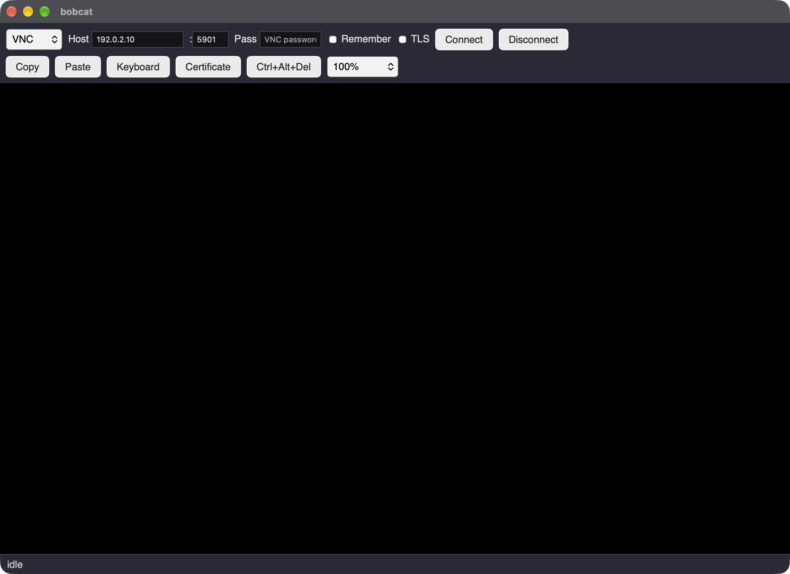
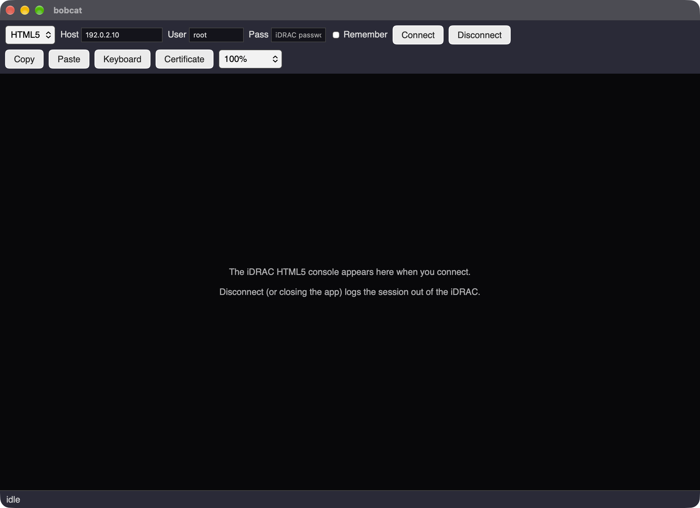
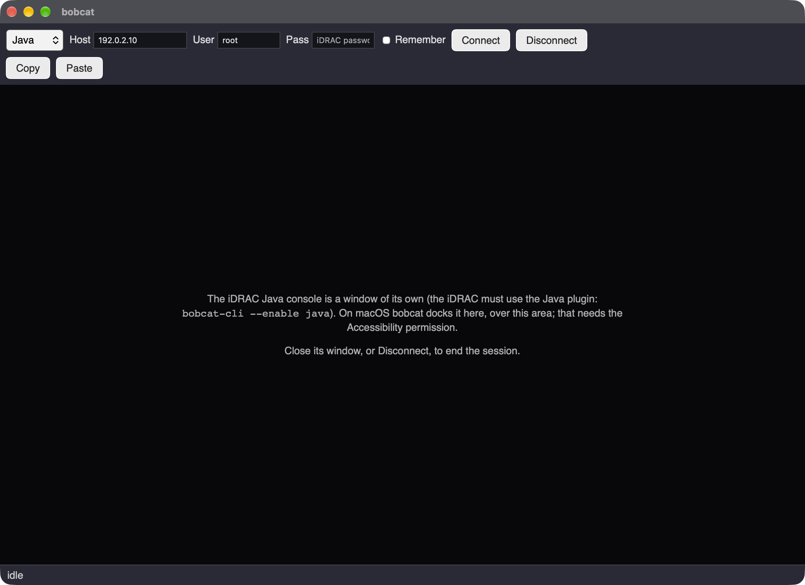
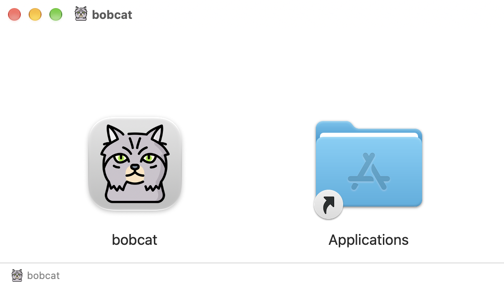

# Bobcat

Version: 1.9.4

**B**MC **O**ut-of-band **B**rowser, **C**onsole **A**ccess **T**ool: a command line tool and a desktop app for
reaching a Dell iDRAC's consoles (graphical VNC, text over SSH or Serial over LAN) and for setting those services up.
It also reaches Intel AMT (vPro) machines: their KVM screen, Serial over LAN, power and boot control.
Tested against an iDRAC8 and an Intel AMT 12 device; the settings it changes are named in `CHANGELOG.md` and `RESEARCH.md`.

| Program | What it is |
|---|---|
| `bobcat-cli` | Command line: enables and disables iDRAC services, opens text consoles in your terminal, and shows the VNC console **as text**. With `--amt`: Intel AMT info, power, boot source, Serial over LAN and the KVM. |
| `bobcat` | Desktop app (Tauri 2): the VNC console as a window, plus SSH and SOL terminals, the Intel AMT KVM and Serial over LAN, on-screen keyboard, copy and paste. |

## bobcat-cli

```
bobcat-cli --ip <iDRAC IP> --user <username> [--check [--install]]
           [--console sol|ssh|vnc [--tls|--notls] [--relearn]]
           [--enable vnc|html5|java|sol [--port 5901] [--sslebl Disabled] [--timeout 300]] [--disable vnc]
           [--disconnect list|media|iso|gui|vc|ssh|sol|sessions|all]
           [--amt [--amt-port 16992] [--info] [--power status|on|off|off-hard|cycle|reset|sleep|hibernate|nmi [--yes]]]
```

**Credentials** are kept off the command line where possible. Omit `--pass` to be prompted, or set `BOBCAT_PASS`
(iDRAC password) / `BOBCAT_VNC_PASS` (VNC password). Add `--save` to keep the iDRAC login password (`--console sol`/`ssh`, `--enable`/`--disable`) and the VNC password (`--console vnc`) in the OS keychain (macOS Keychain, Windows Credential Manager, Linux Secret Service); later runs use them without prompting, and `--forget` removes both for that IP. SSH is done in-process, so no credentials appear in any
process arguments (`--pass` and `--vncpass` do, if you use them).

**Configure the iDRAC** (over SSH, using `racadm`):

| Option | Effect |
|---|---|
| `--enable vnc` | Sets the VNC password (prompted, `--vncpass` or `BOBCAT_VNC_PASS`; 1-8 alphanumeric characters), port (`--port`), SSL encryption (`--sslebl`) and idle timeout (`--timeout`), and enables the VNC server. `--disable vnc` turns it off. |
| `--enable html5` / `java` | Enables the virtual console and selects the HTML5 or Java viewer. |
| `--enable sol` | Enables IPMI over LAN, Serial over LAN and serial redirection. BIOS changes are staged for the next reboot; `bobcat-cli` never reboots the server. |

**End sessions** (over SSH, using `racadm`):

| Option | Effect |
|---|---|
| `--disconnect media` (alias `iso`, `vm`) | Disconnects virtual media (`racadm vmdisconnect`, then `racadm remoteimage -d`), e.g. when a console was closed with an image still mapped and the iDRAC says "Virtual Media is currently unavailable"; also closes any session listed as Virtual Media. A comma list such as `gui,vc` combines them. |
| `--disconnect list` | Shows the iDRAC's sessions (`racadm getssninfo`) and ends nothing. |
| `--disconnect gui` | Closes the web interface (GUI) sessions, by session ID (`racadm closessn -i`). |
| `--disconnect vc` (alias `console`) | Closes the Virtual Console sessions (HTML5, Java). |
| `--disconnect ssh` | Closes the SSH sessions; the one `bobcat-cli` runs in cannot be closed and is left. |
| `--disconnect sol` | Closes the sessions the iDRAC lists as `SOL`: Serial over LAN (`--console sol`) and the serial console opened over SSH (`--console ssh`, `console com2`); the iDRAC lists both the same way. |
| `--disconnect sessions` | Closes every other iDRAC session (web, virtual console, virtual media) with `racadm closessn -a`. |
| `--disconnect all` | Both, media first. |

**Intel AMT (vPro)** (over WS-Management, HTTP digest on port 16992, or 16993 with TLS; add `--amt`, `--ip` is the AMT address and `--user` its admin user, usually `admin`):

| Option | Effect |
|---|---|
| `--amt` (or `--amt --info`) | Shows what the device reports: firmware, host name, provisioning, power state, redirection (SOL/IDER) and KVM state. |
| `--amt --power status\|on\|off\|off-hard\|cycle\|reset\|sleep\|hibernate\|nmi` | Shows or changes the power state. Everything but `on` and `status` asks you to type `yes` first (`--yes` skips it). Only the states the device offers in its current power state are accepted. |
| `--amt --enable vnc` | Turns on the AMT KVM: sets the RFB password (`--vncpass`, `BOBCAT_VNC_PASS` or the prompt; exactly 8 characters with upper case, lower case, a digit and a special character), opens VNC on port 5900 and enables the KVM service. `--disable vnc` turns it off. |
| `--amt --boot hdd\|pxe\|cd\|diag\|bios\|ider-cd\|ider-floppy\|normal\|status` | Chooses what the next start does: boot once from that device, enter the BIOS setup, clear the override, or show the boot settings. It powers nothing: combine it with `--power on` (machine off) or `--power reset` / `cycle`. `--boot-sol` sends the BIOS / boot text to Serial over LAN (then `--console sol`). |
| `--amt --ider-cd FILE.iso` / `--ider-floppy FILE.img` | Virtual media (IDE-R): serves the image read-only to the machine as a CD/DVD or floppy drive until Ctrl+C. `--ider-start reboot\|graceful\|now` says when the machine starts using it. To boot from it, give both in one command: `--amt --ider-cd x.iso --boot ider-cd --power reset` (the session is opened before the boot setting and the power action). Needs IDE-R enabled: `--amt --enable ider`. |
| `--amt --enable sol\|ider` / `--disable ...` | Switches Serial over LAN and IDE-R on or off, leaving the other as it is. |
| `--amt --console vnc` | The text conversion of the AMT KVM screen, through the redirection port (16994, or 16995 with TLS) bridged to a local port. |
| `--amt --amt-redir-test BRIDGE` | The same bridge on its own: prints a local port to point any VNC viewer at (view it from another machine than the one being captured, or it shows its own window inside the picture). |
| `--amt --console sol` | Serial over LAN through the redirection port (16994, or 16995 with TLS; ipmitool does not work with AMT's SOL; it must be enabled in AMT). Disconnect with `~.` at the start of a line or Ctrl+\\. In the desktop app: protocol "AMT SOL". |

With TLS enabled on the device (web services 16993, redirection 16995) bobcat uses it automatically; `--tls` / `--notls` force the choice and `--amt-port` overrides the port. The device's certificate is pinned on first use. In the desktop app the AMT and AMT SOL entries show two extra rows: virtual media (ISO path, Browse, start mode, Mount, Unmount, Mount and boot) and power and boot controls (Status, On, Reset, Cycle, Off, Next start, Enable IDE-R).

**Consoles:**

| Option | What you get |
|---|---|
| `--console ssh` | The server's serial console through the iDRAC's SSH shell (`console com2`). Leave with `~.` at the start of a line, or `Ctrl+\`. |
| `--console sol` | The serial console over IPMI Serial over LAN via `ipmitool`. Leave with `~.`. |
| `--console vnc` | The graphical VNC console **as text**, with keyboard input. |

The server has to send its console to serial for `ssh` and `sol` (see `--enable sol`).

**How `--console vnc` works.** The screen is cut into character cells. Each distinct character shape is named once
by running `tesseract` over the screen and voting across all its occurrences, and every later refresh is read by
exact shape lookup, so it is quick and stable. It needs a text console with a fixed-size bitmap font (the Linux
console, BIOS text screens); graphical screens are reported as "no text console detected". TLS is on by default
(`--notls` for plain VNC); log in with the VNC password and leave with `~.` at the start of a line. The learned
character table is saved per iDRAC in `~/.cache/bobcat/glyphs.json` so later runs start faster (`--relearn`
starts over). `BOBCAT_ONCE=1` prints the screen once and exits (for scripts).

**Trust.** The iDRAC's SSH host key and TLS certificate are pinned the first time they are seen (trust on first
use, saved in `~/.config/bobcat/known_certs.json`, shared with `bobcat`) and the connection is refused if they
change. `--trust-new-hostkey` accepts a changed key or certificate.

**Packages.** `bobcat-cli --check` verifies that `ipmitool`, `tesseract` and the GUI's libraries are installed;
add `--install` to install missing ones (and `rpmbuild` and `gh`) with the platform's package manager (apt, dnf or zypper chosen from `/etc/os-release`; sudo prompts for its own password) or, on macOS, Homebrew (and Rosetta 2 on Apple Silicon). It also reports, without failing, whether Homebrew, Rosetta 2 (macOS), `rpmbuild` (Linux, only for `build.sh --package rpm`), `gh` (the GitHub CLI, only for `build.sh --release`) and a Java runtime (for the GUI's Java console) are present.

## bobcat



*The desktop app (macOS shown). The toolbar picks the protocol (VNC, HTML5, Java, AMT, SSH, SOL or AMT SOL), the host and login, and the second row has Copy, Paste, the on-screen keyboard, the certificate button and text size.*

| HTML5 console | Java console |
|---|---|
|  |  |

*HTML5 and Java views before connecting. The HTML5 console opens inside this window under the toolbar; on macOS the Java console's own window is docked over the same area.*

```
cd gui/src-tauri
BOBCAT_VNC_PASS='<vnc password>' cargo run
```

Requires the Tauri 2 Linux dependencies (WebKitGTK 4.1). No Node/npm needed. Enter the iDRAC IP and password
(prefilled from `BOBCAT_VNC_PASS`) and click Connect.

Choose the **Protocol**: VNC (default, the graphical console), **HTML5** (Dell's own web console), **Java** (Dell's Java console, in a window of its own), **AMT SOL** (the serial console of an Intel AMT device, no ipmitool needed), **AMT** (the KVM of an Intel AMT device, drawn in the canvas like VNC: host, user `admin` and the AMT password; no port or TLS setting), **SSH**
(the iDRAC's `console com2`) or **SOL** (IPMI Serial over LAN via `ipmitool`). HTML5, Java, SSH and SOL need the iDRAC username
and password; SSH and SOL show a terminal.
`BOBCAT_PROTOCOL=vnc|html5|java|amt|ssh|sol|amtsol`, `BOBCAT_USER` and `BOBCAT_PASS` set the starting values. The **Remember** checkbox keeps the password in the OS keychain (the iDRAC login for SSH, SOL, HTML5 and Java, shared with `bobcat-cli`; the VNC password for VNC); unticking it and connecting deletes the entry.

- **HTML5:** logs in to the iDRAC web interface (certificate checked against the pin first) and shows its HTML5
  console inside the main window, under the toolbar (a second web view; a small certificate window flashes up for
  about 3 seconds while the viewer sets itself up). Disconnect, closing the app, Ctrl+C or SIGTERM disconnect the
  viewer and log the session out. The HTML5 viewer must be selected on the iDRAC (`bobcat-cli --enable html5`).
  The console is Dell's own page, so its keyboard, mouse and menus are Dell's. Bobcat's **Copy** (reads the
  screen with OCR; needs `tesseract-ocr`), **Paste** (types your clipboard in, US layout) and **text size**
  (zoom) buttons work on it and sit on the second toolbar row beside Certificate; the on-screen keyboard is not used.
- **Java** (macOS and 64-bit Linux): logs in, downloads Dell's viewer from the iDRAC over the pinned connection (once; later sessions reuse the copy in `~/.config/bobcat/java-viewer/<ip>/` unless the iDRAC's files changed) and
  runs it with `java`, in a window of its own (it cannot be embedded; on macOS, with the Accessibility permission, bobcat docks that window over the console area of the main window and keeps it there as the window moves or is resized, and its **Paste** (types your clipboard in as key presses) and **Copy** (reads the screen with OCR; needs the Screen Recording permission) buttons work; `BOBCAT_JAVA_DOCK=0` turns this off). The Java viewer must be selected on the iDRAC
  (`bobcat-cli --enable java`). On macOS the viewer's native libraries are Intel-only, so it needs an x86_64 Java 8:
  the first time, bobcat asks and then downloads Azul Zulu 8 into `~/.config/bobcat/java` (checksum checked, nothing
  installed system-wide; Rosetta 2 is needed on Apple Silicon). `BOBCAT_JAVA=<path to java>` uses another runtime
  (on Linux `java` from the PATH is used). Virtual media is off (`BOBCAT_JAVA_VM=1` keeps what the iDRAC asks for).
  The viewer checks the iDRAC's certificate itself and warns when it does not chain to a known root. On macOS bobcat
  sets the viewer's "User's Certificate Store Path" (unless you have set your own) to `~/.config/bobcat/java-trust` and
  puts the iDRAC's certificate there once bobcat has checked it against its pin (trust on first use), so the viewer's
  warning does not appear; a changed certificate is refused by bobcat and never added.
  Close the viewer's window or press Disconnect to end the session; the viewer's output is in
  `~/.config/bobcat/java-viewer/<ip>/viewer.log`. The viewer's own warning that its keyboard library failed to load
  is harmless (typed text still works; some keys and Single Cursor mode do not).
- **VNC:** click the screen to send keyboard and mouse input (Ctrl+Alt+Del button provided). Compressed Zrle
  updates are requested; set `BOBCAT_ENCODING=raw` to force uncompressed Raw.
- **TLS:** if VNC SSL encryption is enabled on the iDRAC (`bobcat-cli --enable vnc --sslebl Auto_Negotiate`),
  tick **TLS** before connecting (or set `BOBCAT_TLS=1`). The iDRAC takes 10-15 seconds to complete the handshake.
  Its self-signed certificate is saved the first time you connect and a changed one blocks the connection; the
  **Certificate** button (**Host key** for SSH) shows it and can trust a new one.
- **Keyboard:** the on-screen keyboard has US/UK/DE/FR layouts, can be dragged by its title bar, and works in every
  protocol (click Shift/Ctrl/Alt/Meta first for combinations).
- **Paste** (button or Ctrl+Shift+V): types your clipboard into the console (US layout) or pastes into the terminal.
- **Copy text:** in VNC, drag over the text on screen to read it with OCR (needs `tesseract-ocr`; best on plain text
  consoles); in SSH/SOL it copies the selection, or the whole visible screen.
- **Text size:** the drop-down zooms the console; **Fit window** scales it to the window.
- Closing the window (or Ctrl+C) hangs up SSH and SOL sessions cleanly so the iDRAC releases them.

## How Bobcat compares

What Bobcat adds on top of the consoles the iDRAC offers. "Not offered" means the viewer has no such feature as found on an iDRAC8 (not taken from Dell's documentation, and newer firmware or other viewers may differ); a stock VNC client is any ordinary VNC viewer connected to the iDRAC's VNC server, where features depend on the client.

| | Bobcat | iDRAC HTML5 viewer (browser) | iDRAC Java viewer | Stock VNC client |
|---|---|---|---|---|
| **Paste** your clipboard into the console | Yes: VNC, HTML5, SSH, SOL (Ctrl+Shift+V); Java on macOS | Not offered | Not offered | Client-dependent |
| **Copy text** from the console screen | Yes: drag over the text, read with OCR (VNC; HTML5 on Linux; Java on macOS); terminal selection (SSH, SOL) | Not offered | Not offered | Not offered (a screen is pixels) |
| Server clipboard text to your clipboard | Yes (VNC) | Not offered | Not offered | Client-dependent |
| **Text size** zoom and **Fit window** | Yes (VNC, HTML5) | Browser zoom only | Viewer scaling | Client-dependent |
| On-screen keyboard (US, UK, DE, FR) | Yes (VNC, AMT KVM, SSH, SOL) | Dell's own | Dell's own | Client-dependent |
| Several console types in one app | VNC, HTML5, Java, SSH, SOL, and Intel AMT (KVM, SOL) | HTML5 only | Java only | VNC only |
| Embedded in the main window | VNC, HTML5, SSH, SOL (Java in its own window) | A browser tab | Its own window | Its own window |
| Certificate checking | Pinned on first use for web, VNC TLS, AMT TLS and SSH; a change blocks the connection | Browser warning each time for a self-signed certificate | The viewer's own warning dialog | Client-dependent |
| Password in the OS keychain | Yes (Remember), shared with the CLI | Browser password manager | No | Client-dependent |
| Turn the console services on (VNC, HTML5, Java, SOL) | Yes: `bobcat-cli --enable ...` over SSH/racadm | In the iDRAC web interface | In the iDRAC web interface | No |
| Screen as **text** in a terminal | Yes: `bobcat-cli --console vnc` | No | No | No |
| Session released when you disconnect | Yes (graceful logout; closing the app, Ctrl+C and SIGTERM too) | When the tab closes cleanly | Only when its window is closed | Client-dependent |
| Needs | Nothing extra for VNC, HTML5, SSH, SOL; Java 8 (downloaded for you) for the Java console | A browser | A Java runtime, and Rosetta 2 on Apple Silicon | A VNC client |

### Intel AMT

For an Intel AMT (vPro) machine the usual tool is MeshCommander (version 0.9.5-a was used for comparison: a Node.js web console you open in a browser, which Bobcat's AMT protocol work follows). "Not on the test device" means found on the AMT 12 device used for testing, where the device's own VNC port could not be enabled and ipmitool's SOL did not work. Rows marked *untested* are written and build but have not been run against a device.

| | Bobcat | MeshCommander | ipmitool | Stock VNC client |
|---|---|---|---|---|
| Graphical KVM | Yes: in the app (canvas, with keyboard and mouse), or bridged to a local port for any VNC viewer | Yes, in its browser page | No | Only through Bobcat's bridge (the device's own port 5900 could not be enabled on the test device) |
| Serial over LAN | Yes: `--console sol`, app entry "AMT SOL" | Yes | Does not work with AMT on the test device | No |
| Power actions | `--power` and the app's Power buttons (status works; the changes are *untested*) | Yes | Not tried | No |
| Boot source (PXE, disk, CD, BIOS setup) | `--boot` and the app's Next start (`status` works; the overrides are *untested*) | Yes | Not tried | No |
| IDER (virtual media) | `--ider-cd` / `--ider-floppy` (command line) and a Mount row in the app (ISO only, plus "Mount and boot"); read-only; an ISO mounts on the host, booting from it is *untested* | Yes (CD/DVD and floppy images) | No | No |
| TLS | Yes, automatic when the device has it; certificate pinned on first use | Yes (an option per connection) | n/a | n/a |
| Paste, text size, on-screen keyboard in the KVM | The same controls as the VNC console (paste and copy not yet tried on AMT) | Not checked | n/a | Client-dependent |
| Password in the OS keychain | Yes (Remember) | Not checked | No | Client-dependent |
| Screen as **text** in a terminal | Yes: `--amt --console vnc` (not yet tried) | No | No | No |
| Needs | Nothing extra | Node.js and a browser | ipmitool | A VNC client |

## Building installers

```
./build.sh --target mac        # dist/bobcat_<version>_<arch>.dmg and dist/bobcat-cli-<version>-mac
./build.sh --target mac --arch universal   # or arm64 / x64
./build.sh --target linux      # the distribution's own package: .deb on Debian/Ubuntu, .rpm on RHEL/Fedora/Alma/Rocky/SUSE, else .AppImage (build on Linux)
./build.sh --target linux --package rpm   # or deb / appimage / all, or a list like deb,rpm (rpm needs rpmbuild)
./build.sh --target deb        # shortcut for --target linux --package deb (also --target rpm)
./build.sh --target windows    # NSIS setup.exe (build on Windows, e.g. Git Bash)
```

`./build.sh --release` (with or without a `--target`) tags the commit `v<version>`, pushes the tag and creates the GitHub
release with the installers in `dist/` for that version (needs `gh`, logged in; notes come from `CHANGELOG.md`). Run it on each
platform's machine to add that platform's files to the same release. It never commits: commit and push first. `--draft`
makes a draft release, `--dry-run` shows what it would do, `--yes` skips the question.
`./build.sh --delete-release [<version>]` deletes that release (default: the current version) and its tag after asking; `--keep-tag` keeps the tag, `--yes` skips the question, `--dry-run` only prints.



*The macOS installer (`bobcat_<version>_<arch>.dmg`): drag bobcat onto Applications.*

Needs the Rust toolchain and `cargo install tauri-cli --version '^2'` (and `perl` for the bundled OpenSSL). Each target
must be built on its own platform. The macOS app is not signed or notarized: on first launch right-click it and choose
Open (or run `xattr -dr com.apple.quarantine /Applications/bobcat.app`). The first connection from the built app asks for Local Network access; allow it (System Settings >
Privacy & Security > Local Network), otherwise connections fail with "No route to host". Only the macOS (arm64) build has been
tried.

## Files and variables

| | |
|---|---|
| `~/.config/bobcat/known_certs.json` | Pinned TLS certificates and SSH host keys (both programs). |
| `~/.cache/bobcat/glyphs.json` | Learned character table for `--console vnc`. |
| `BOBCAT_*` | `PASS`, `VNC_PASS`, `USER`, `PROTOCOL`, `TLS`, `AUTOCONNECT`, `ENCODING`, `ONCE`, `DUMP`, `DEBUG` (`1`, or `2` for bytes). |

This project used to be called dracon. The old `~/.config/dracon-gui` and `~/.cache/dracon-cli` files are still read (and
copied to the new locations); the old `DRACON_*` environment variables are no longer used, only `BOBCAT_*`.

## Known issues

### Java console: keyboard library warning (macOS)

The Java viewer shows this warning when it starts:

> The Native library for keyboard and mouse support failed to load!
> To pass all keystrokes to the managed system, the
> Virtual Console application requires direct access to your keyboard. You can enable this in System Preferences -> Universal Access and select "Enable access for assistive devices" option.
> If this option is not enabled, the typed characters are passed to the managed system, but not all keyboard functions will work properly, and Single Cursor mode cannot be enabled.

Typed text still reaches the server. Bobcat cannot set the option itself: on current macOS it is the Accessibility permission (System Settings > Privacy & Security > Accessibility), which only the user can grant. Granting it to Bobcat removes the warning (confirmed on macOS). The viewer has no clipboard paste of its own; on macOS Bobcat's Paste types into it with the same permission.

## License

Licensed under CC BY-NC-SA 4.0. See [LICENSE.md](LICENSE.md).

## Help Support Development

If you find this software useful and would like to support its development, please consider buying me a coffee:

https://ko-fi.com/richardatlateralblast

## Third-party

`gui/ui/vendor/` contains xterm.js 5.5.0 and its fit addon (MIT licence, see `gui/ui/vendor/xterm-LICENSE`).

Bobcat image: <a href="https://www.flaticon.com/free-icons/pixie-bob" title="pixie bob icons">Pixie bob icons created by Magnific - Flaticon</a>
